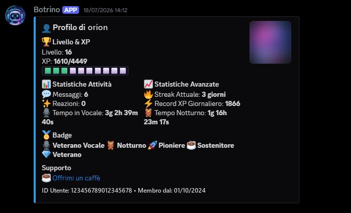
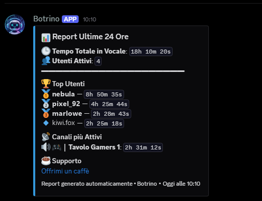

# Botrino

Bot Discord per il coinvolgimento della community: XP e livelli, tracciamento dell'attività vocale, badge, record del server e report automatici.

[](https://www.python.org/)
[](https://github.com/Rapptz/discord.py)
[](LICENSE)
[](https://github.com/BotrugnoMarco/botrino/actions/workflows/test.yml)

🇬🇧 [Read in English](README.md)

<!--
  Screenshot: salva le immagini in docs/ e decommenta le righe qui sotto.
  
  
-->

## Funzionalità

- **Sistema XP**: gli utenti guadagnano XP inviando messaggi (con cooldown), restando nei canali vocali, aggiungendo reazioni e ricevendo reazioni ai propri messaggi.
- **Curva di livello non lineare**: l'XP necessario cresce rapidamente nei primi livelli e poi si appiattisce.
- **Ruoli per livello**: ruoli assegnati automaticamente al raggiungimento di un livello.
- **Badge**: 17 traguardi (messaggi, ore in vocale, attività notturna, strisce di attività, tempo in webcam e in streaming, livelli, record del server), con notifica in DM allo sblocco.
- **Record del server**: una "Hall of Fame" con i record attuali e chi li detiene.
- **Report**: report giornaliero dell'attività vocale (ultime 24 ore, alle 09:00) e settimanale (lunedì alle 10:00), con i canali più attivi e l'uso della soundboard.
- **AFK automatico**: chi resta mutato oltre un timeout configurabile viene spostato nel canale AFK.
- **Messaggi di benvenuto** per i nuovi membri.

## Comandi

Il prefisso è `!`.

### Comandi utente

| Comando | Descrizione |
| --- | --- |
| `!report` | Report dell'attività vocale delle ultime 24 ore |
| `!leaderboard` | Classifica per tempo totale nei canali vocali |
| `!level [utente]` | Livello, XP e barra di progresso tuoi o di un altro utente |
| `!level_leaderboard` | Classifica per livello |
| `!records` | Hall of Fame del server |
| `!profile [utente]` | Profilo completo con statistiche e badge |
| `!badges [utente]` | Badge guadagnati da te o da un altro utente |
| `!donate` | Link per supportare il bot |
| `!help_botrino` | Lista dei comandi disponibili |

### Comandi admin

Richiedono il permesso *Amministratore*.

| Comando | Descrizione |
| --- | --- |
| `!benvenuto @utente [@utente2 ...]` | Invia (o re-invia) il messaggio di benvenuto |
| `!ricalcola [conferma]` | Ricalcola tempo vocale, tempo notturno e record XP giornaliero dai dati grezzi (senza `conferma` mostra solo l'anteprima) |
| `!assegna_badge @utente <id_badge>` | Assegna manualmente un badge |
| `!force_check_badges [@utente]` | Forza il controllo dei badge di un utente |
| `!ricalcola_badge [conferma]` | Sincronizza i badge di tutti gli utenti (assegna i mancanti, revoca quelli non più meritati) |
| `!say #canale <messaggio>` | Fa inviare un messaggio al bot in un canale |
| `!annuncio_v3 [#canale]` | Pubblica l'annuncio dell'aggiornamento v3.0 |
| `!announce_updates` | Pubblica le ultime novità nel canale aggiornamenti (nascosto) |

### Comandi owner (nascosti)

| Comando | Descrizione |
| --- | --- |
| `!sim_daily` | Esegue subito il report giornaliero |
| `!sim_weekly` | Esegue subito il report settimanale |

## Requisiti

- Python 3.9 o successivo (testato su 3.11 e 3.12)
- Un server MySQL
- Un token di bot Discord con gli intent **Server Members** e **Message Content** attivi

## Installazione

```bash
git clone https://github.com/BotrugnoMarco/botrino.git
cd botrino

python3 -m venv venv
source venv/bin/activate        # Windows: venv\Scripts\activate
pip install -r requirements.txt

cp .env.example .env            # poi compila i valori
mysql -u <utente> -p < setup.sql
```

`setup.sql` crea il database `discord_bot` e le tabelle, e si può rieseguire senza rischi su un'installazione esistente. Se usi un altro nome per il database, aggiorna sia `setup.sql` sia `MYSQL_DB`.

## Avvio

```bash
python bot.py
```

I log vengono scritti in `logs/bot.log`.

## Configurazione

Tutte le impostazioni sono nel file `.env`: vedi [`.env.example`](.env.example), dove ogni variabile è documentata e segnata come obbligatoria o opzionale.

| Variabile | Funzione |
| --- | --- |
| `DISCORD_TOKEN` | Token del bot (obbligatoria) |
| `MYSQL_HOST`, `MYSQL_USER`, `MYSQL_PASSWORD`, `MYSQL_DB` | Credenziali del database (obbligatorie) |
| `REPORT_CHANNEL_ID` | Canale dei report giornalieri e settimanali (obbligatoria) |
| `WELCOME_CHANNEL_ID` | Canale dei messaggi di benvenuto (obbligatoria) |
| `ZONE` | Fuso orario di report e statistiche, es. `Europe/Rome` (default `UTC`) |
| `XP_PER_MESSAGE`, `XP_PER_MINUTE`, `XP_PER_REACTION`, `XP_FOR_REACTION_RECEIVED` | XP assegnati per ogni attività |
| `BASE_XP_FOR_LEVEL_UP` | XP necessari per passare dal livello 0 al livello 1 |
| `LEVEL_ROLES` | Ruoli per livello, formato `5:id_ruolo,15:id_ruolo` |
| `AFK_CHANNEL_IDS`, `AFK_MOVE_TIMEOUT_MINUTES` | Canali AFK e timeout per lo spostamento degli utenti mutati |
| `WEBHOOK_URL` | Webhook per le notifiche di avvio, arresto ed errori |
| `KOFI_USERNAME` | Username Ko-fi per i link di supporto |

## Produzione con `botctl.sh`

`botctl.sh` gestisce il bot su un server Linux. Legge il `.env` dalla propria cartella; imposta `VENV` con lo script di attivazione del virtualenv.

```bash
./botctl.sh start     # avvio in background
./botctl.sh stop      # arresto (attende il salvataggio delle sessioni vocali)
./botctl.sh restart
./botctl.sh status    # PID e tempo di attività
./botctl.sh logs      # segue logs/bot.log
./botctl.sh update    # git pull, aggiornamento dipendenze e riavvio
```

Se `WEBHOOK_URL` è impostata, ogni azione viene notificata su Discord.

## Test

```bash
pip install -r requirements-dev.txt
pytest
```

I test vengono eseguiti anche su GitHub Actions a ogni push e pull request.

## Struttura del progetto

```
botrino/
├── bot.py                  # Punto di ingresso: configurazione, avvio e spegnimento
├── queries.py              # Query SQL
├── setup.sql               # Schema del database
├── botctl.sh               # Script di gestione in produzione
├── cogs/
│   ├── activity_events.py  # Tracciamento di voce, messaggi e reazioni, XP, livelli, benvenuto
│   ├── badges.py           # Sistema dei badge
│   ├── commands.py         # Comandi utente e admin
│   └── tasks.py            # Task pianificati: report, XP periodico, AFK
├── utils/
│   ├── database.py         # Connessione MySQL e keep-alive
│   ├── formatters.py       # Durate, classifiche ed embed dei report
│   └── xp_utils.py         # Curva di livello
├── tests/
│   └── test_xp_utils.py    # Test della curva di livello
├── .env.example            # Modello di configurazione
├── requirements.txt
└── requirements-dev.txt
```

## Licenza

Rilasciato con [licenza MIT](LICENSE).

Se il progetto ti è utile, puoi supportarlo su [Ko-fi](https://ko-fi.com/dlayk_mark) ☕
