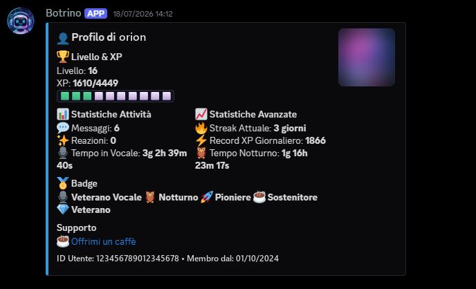
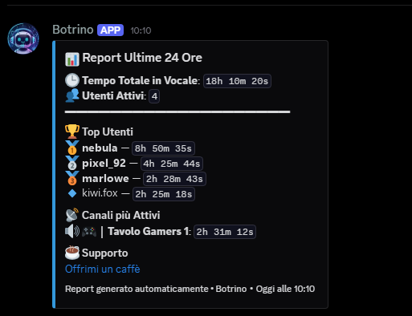

# Botrino

A Discord bot for community engagement: XP and levels, voice activity tracking, badges, server records and automatic activity reports.

[](https://www.python.org/)
[](https://github.com/Rapptz/discord.py)
[](LICENSE)
[](https://github.com/BotrugnoMarco/botrino/actions/workflows/test.yml)

🇮🇹 [Leggi in italiano](README.it.md)

> The bot's commands and messages are in Italian.

<p>
  
  
</p>

## Features

- **XP system**: users earn XP by sending messages (with a cooldown), spending time in voice channels, adding reactions and receiving reactions on their messages.
- **Non-linear level curve**: the XP needed per level grows quickly in the first levels and then flattens out.
- **Level roles**: roles assigned automatically when a level is reached.
- **Badges**: 17 achievements (messages, voice hours, night owl, streaks, webcam and streaming time, levels, server records), with a DM notification when unlocked.
- **Server records**: a "Hall of Fame" with the current records and who holds them.
- **Reports**: a daily voice activity report (last 24 hours, at 09:00) and a weekly one (Monday at 10:00), including the most active channels and soundboard usage.
- **Automatic AFK**: users who stay muted longer than a set timeout are moved to the AFK channel.
- **Welcome messages** for new members.

## Commands

The prefix is `!`.

### User commands

| Command | Description |
| --- | --- |
| `!report` | Voice activity report for the last 24 hours |
| `!leaderboard` | Leaderboard by total time spent in voice channels |
| `!level [user]` | Level, XP and progress bar for you or another user |
| `!level_leaderboard` | Leaderboard by level |
| `!records` | Server Hall of Fame |
| `!profile [user]` | Full profile with stats and badges |
| `!badges [user]` | Badges earned by you or another user |
| `!donate` | Link to support the bot |
| `!help_botrino` | List of available commands |

### Admin commands

They require the *Administrator* permission.

| Command | Description |
| --- | --- |
| `!benvenuto @user [@user2 ...]` | Sends (or re-sends) the welcome message |
| `!ricalcola [conferma]` | Recalculates voice time, night time and daily XP record from raw data (preview only, applies the changes with `conferma`) |
| `!assegna_badge @user <badge_id>` | Manually awards a badge |
| `!force_check_badges [@user]` | Forces a badge check for a user |
| `!ricalcola_badge [conferma]` | Syncs the badges of all users (awards missing ones, revokes those no longer earned) |
| `!say #channel <message>` | Makes the bot send a message in a channel |
| `!annuncio_v3 [#channel]` | Publishes the v3.0 update announcement |
| `!announce_updates` | Publishes the latest updates in the updates channel (hidden) |

### Owner commands (hidden)

| Command | Description |
| --- | --- |
| `!sim_daily` | Runs the daily report immediately |
| `!sim_weekly` | Runs the weekly report immediately |

## Requirements

- Python 3.9 or later (tested on 3.11 and 3.12)
- A MySQL server
- A Discord bot token with the **Server Members** and **Message Content** intents enabled

## Installation

```bash
git clone https://github.com/BotrugnoMarco/botrino.git
cd botrino

python3 -m venv venv
source venv/bin/activate        # Windows: venv\Scripts\activate
pip install -r requirements.txt

cp .env.example .env            # then fill in the values
mysql -u <user> -p < setup.sql
```

`setup.sql` creates the `discord_bot` database and its tables, and can be run again safely on an existing installation. If you use a different database name, update both `setup.sql` and `MYSQL_DB`.

## Running

```bash
python bot.py
```

Logs are written to `logs/bot.log`.

## Configuration

All settings are in `.env`: see [`.env.example`](.env.example), where every variable is documented and marked as required or optional.

| Variable | Purpose |
| --- | --- |
| `DISCORD_TOKEN` | Bot token (required) |
| `MYSQL_HOST`, `MYSQL_USER`, `MYSQL_PASSWORD`, `MYSQL_DB` | Database credentials (required) |
| `REPORT_CHANNEL_ID` | Channel for the daily and weekly reports (required) |
| `WELCOME_CHANNEL_ID` | Channel for welcome messages (required) |
| `ZONE` | Time zone for reports and stats, e.g. `Europe/Rome` (default `UTC`) |
| `XP_PER_MESSAGE`, `XP_PER_MINUTE`, `XP_PER_REACTION`, `XP_FOR_REACTION_RECEIVED` | XP awarded for each activity |
| `BASE_XP_FOR_LEVEL_UP` | XP needed to go from level 0 to level 1 |
| `LEVEL_ROLES` | Roles awarded per level, format `5:role_id,15:role_id` |
| `AFK_CHANNEL_IDS`, `AFK_MOVE_TIMEOUT_MINUTES` | AFK channels and timeout for moving muted users |
| `WEBHOOK_URL` | Webhook for startup, shutdown and error notifications |
| `KOFI_USERNAME` | Ko-fi username for the support links |

## Production with `botctl.sh`

`botctl.sh` manages the bot on a Linux server. It reads `.env` from its own folder; set `VENV` to the virtualenv activation script.

```bash
./botctl.sh start     # start in the background
./botctl.sh stop      # stop (waits for active voice sessions to be saved)
./botctl.sh restart
./botctl.sh status    # PID and uptime
./botctl.sh logs      # follow logs/bot.log
./botctl.sh update    # git pull, update dependencies and restart
```

If `WEBHOOK_URL` is set, every action is notified on Discord.

## Tests

```bash
pip install -r requirements-dev.txt
pytest
```

Tests also run on GitHub Actions on every push and pull request.

## Project structure

```
botrino/
├── bot.py                  # Entry point: configuration, startup and shutdown
├── queries.py              # SQL queries
├── setup.sql               # Database schema
├── botctl.sh               # Production management script
├── cogs/
│   ├── activity_events.py  # Voice, message and reaction tracking, XP, levels, welcome
│   ├── badges.py           # Badge system
│   ├── commands.py         # User and admin commands
│   └── tasks.py            # Scheduled tasks: reports, periodic XP, AFK
├── utils/
│   ├── database.py         # MySQL connection and keep-alive
│   ├── formatters.py       # Durations, leaderboards and report embeds
│   └── xp_utils.py         # Level curve
├── tests/
│   └── test_xp_utils.py    # Level curve tests
├── .env.example            # Configuration template
├── requirements.txt
└── requirements-dev.txt
```

## License

Released under the [MIT License](LICENSE).

If you find the project useful, you can support it on [Ko-fi](https://ko-fi.com/dlayk_mark) ☕
